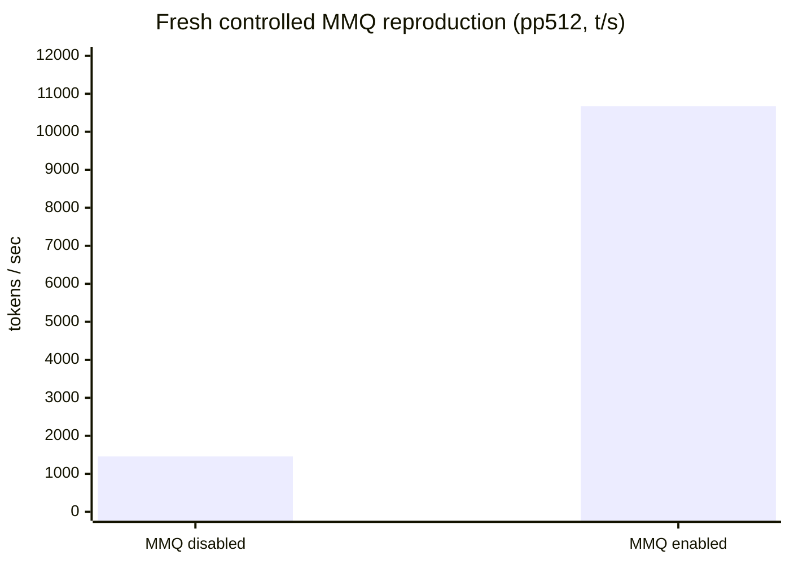
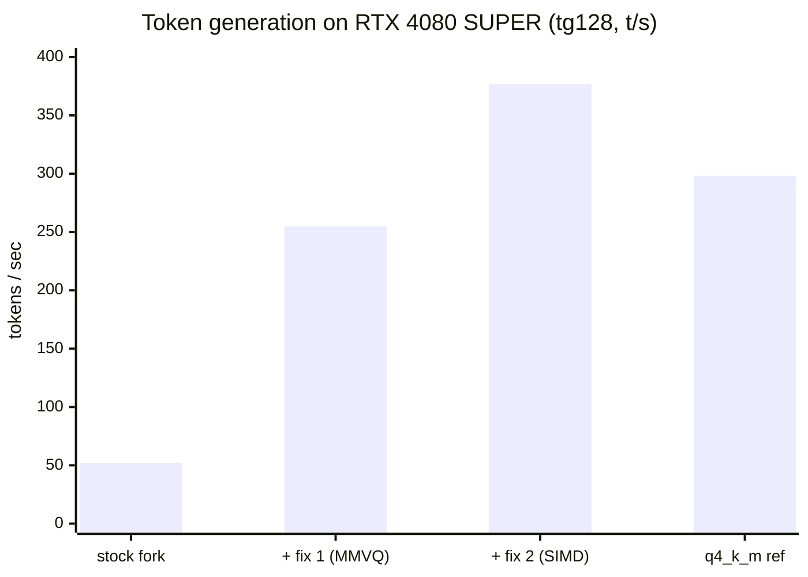
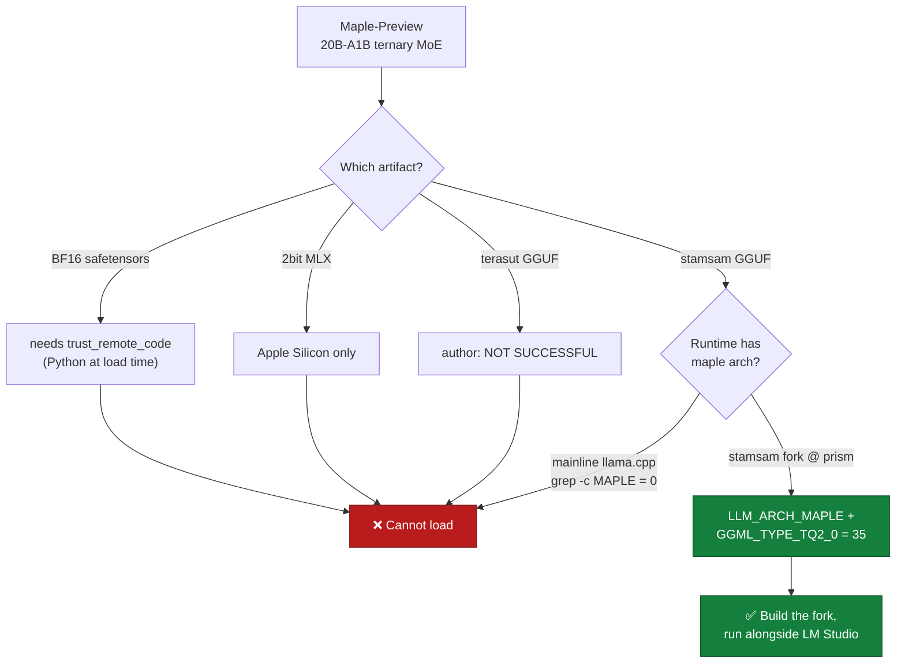
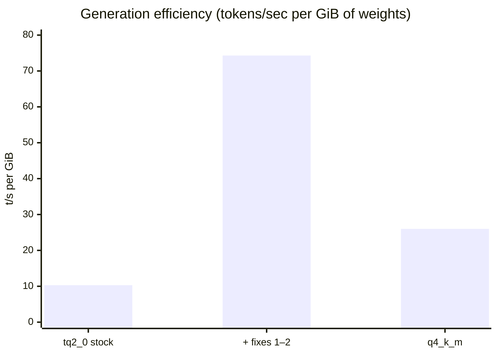
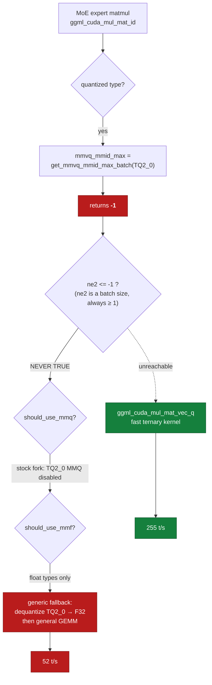
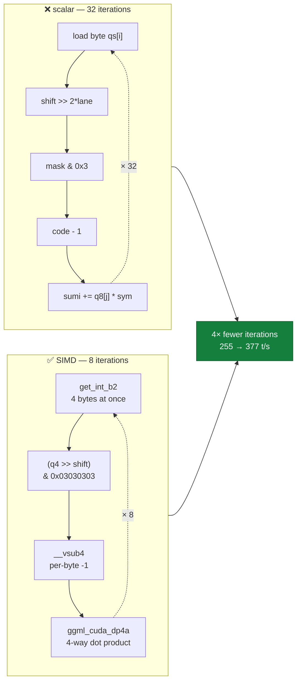
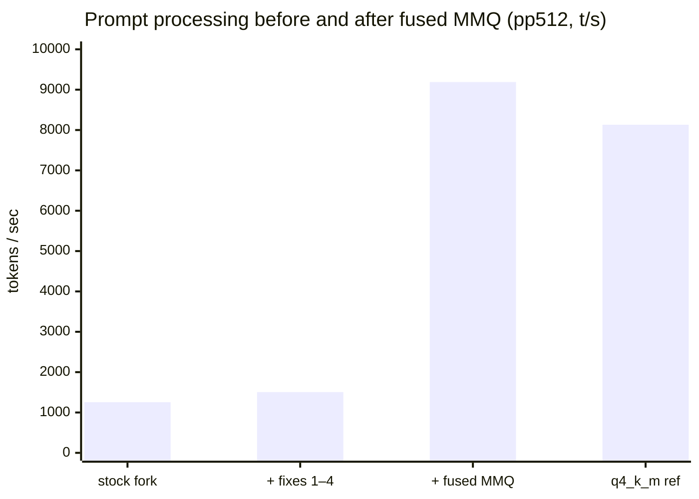
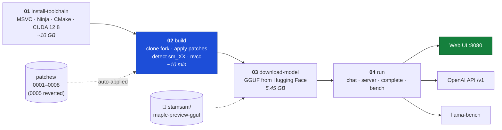

# Running Maple-Preview locally on Windows + CUDA

Four setup scripts that take a stock Windows machine to a running
[Maple-Preview](https://huggingface.co/deepgrove/maple-preview) — a 20B-A1B
**ternary-weight** MoE reasoning model — served over an OpenAI-compatible API on
consumer hardware.

No weights are committed here. Everything is pulled from Hugging Face at setup
time.

---
## Headline

llama.cpp cannot load the deepgrove/maple-preview ternary model: it lacks both the `maple` architecture and the `tq2_0` tensor type (GGML type 35). Even when the architecture is forked in, the original CUDA kernels for ternary weights were 7× slower than the q4_k_m reference on consumer hardware. This repo builds the working fork on Windows and ships seven local patches that make both generation and prompt processing faster than q4_k_m in **44% of the memory**.

### TL;DR

- **Generation (tg128)**: 52 → 362 t/s on RTX 4080 SUPER — past `q4_k_m`'s 298 t/s
- **Prompt processing (pp512)**: 1256 → 9189 t/s — 13% past `q4_k_m`'s 8130 t/s
- **Memory**: 7.3 GB vs `q4_k_m`'s 12.3 GB — the ternary argument, validated on hardware
- **Correctness**: 31/31 `MUL_MAT` and 72/72 `MUL_MAT_ID` tests against CPU
- **Fresh reproduction**: 1457 → 10674 pp512 (7.33×) in a warm A/B/B/A run

### Patches

Seven patches are auto-applied by `scripts/02-build.ps1`; pass `-NoPatch` for stock. Number 0005 records a reverted dequant experiment and is intentionally absent from `patches/`.

|Patch|What|Where|Impact (RTX 4080 SUPER)|
|---|---|---|---|
|0001|enable MMVQ for batch-1 MoE (was unreachable guard)|`fork/ggml/src/ggml-cuda/mmvq.cu`|tg: 52 → 255 t/s (4.9×)|
|0002|SIMD ternary vec_dot (`__vsub4` + `dp4a`)|`fork/ggml/src/ggml-cuda/vecdotq.cuh`|tg: 255 → 377 t/s (7.2× total)|
|0003|enable tq2_0 in test-backend-ops|`fork/tests/test-backend-ops.cpp`|103/103 unit tests against CPU|
|0004|specialized 32-thread dequant kernel|`fork/ggml/src/ggml-cuda/convert.cu`|pp: 1422 → 1531 (+7.6%), tg: 353 → 369 (+4.4%)|
|0005|vectorized uint16_t dequant|*(reverted — regressed ~2%)*|—|
|0006|wire dormant TQ2_0 MMQ dispatch and sizing|`fork/ggml/src/ggml-cuda/mmq.cu`, `mmq.cuh`|compile-only prerequisite|
|0007|natural-K TQ2_0 shared-memory tile loader|`fork/ggml/src/ggml-cuda/mmq.cuh`|correctness prerequisite|
|0008|enable TQ2_0 MMQ and register its generated instance|`fork/ggml/src/ggml-cuda/mmq.cu`|pp: 1505 → 9189 t/s (6.1×); 103/103 tests|

**0001 / 0002** are the headline pair. 0001 is a single-line guard fix — the ternary MMVQ kernel existed and was wired for MoE expert routing, but `get_mmvq_mmid_max_batch` returned `-1` and the call site tested `ne2 <= -1`, which is unreachable since `ne2` is a batch size ≥ 1. 0002 vectorizes `vec_dot_tq2_0_q8_1`: 4 codes per step using `__vsub4` (per-byte subtract, not plain integer — avoids borrow across codes) and `ggml_cuda_dp4a` for the 4-way dot product. 32 scalar iterations → 8 SIMD iterations.

**0003 / 0004** are the supporting pair. 0003 wires ternary into `test-backend-ops`, which had it commented out with `// TODO: implement for all backends` — that omission is how the 0001 bug survived. 0004 adds a specialized `dequantize_block_tq2_0` kernel mirroring `dequantize_block_q4_0`: 32 threads/block, each reads one byte per block half and emits 8 fp32 values via per-lane extraction; 8 coalesced fp32 writes per warp.

**0006 / 0007 / 0008** close the prompt-processing gap without a separate ternary MMA implementation. The loader expands TQ2_0's strided 2-bit packing into natural K-order signed bytes, replicates its block scale across the eight Q8_1 scale slots, and reuses llama.cpp's existing signed-s8 Turing MMA consumer. 0008 enables the path after the controlled correctness gate.

### Current state (RTX 4080 SUPER, sm_89)

|Configuration|pp512|tg128|VRAM|
|---|---:|---:|---:|
|stock fork|1256|52|7.3 GB|
|+ patches 0001-0008 (0005 reverted)|**9189**|**362**|7.3 GB|
|q4_k_m reference (mature CUDA)|8130|298|12.3 GB|

The patched ternary build now beats Q4_K in both measured paths while using 44% of the memory: pp512 is 13% faster (9189 vs 8130 t/s), and tg128 is 21% faster (362 vs 298 t/s). The MMQ enablement alone improved pp512 from a matched 1505 to 9189 t/s (6.1×); isolated generation remained unchanged within noise (358.0 vs 361.8 t/s).

#### Reproducibility refresh — 2026-08-09

A fresh warm-state A/B/B/A run on the same RTX 4080 SUPER, now using driver
610.62, reproduced the prompt-path result: **1457 → 10674 pp512 (7.33×)**.
Generation medians were effectively identical at 375.0 vs 374.8 tg128, and the
enabled build again passed all 103 CPU-reference cases. The original 9189/8130
comparison above is retained because its TQ2_0 and Q4_K control were measured in
the same earlier environment; the new run did not re-benchmark Q4_K.



The public [Hugging Face benchmark dataset](https://huggingface.co/datasets/x0me/maple-preview-cuda-benchmarks)
contains every sample, exact patch/model hashes, the benchmark harness, raw
correctness logs, and the sm_86/sm_120 evidence. It contains no model weights.

### Cross-architecture validation

|GPU|CUDA arch|`MUL_MAT`|`MUL_MAT_ID`|pp512|tg128|
|---|---:|---:|---:|---:|---:|
|RTX 2080 Ti|sm_75|31/31|72/72|—|—|
|RTX 3080|sm_86|31/31|72/72|6986|343|
|RTX 4080 SUPER|sm_89|31/31|72/72|9189 original / 10674 refresh|362 original / 370 refresh|
|RTX 5060 Ti|sm_120|31/31|72/72|5738|324|

The fused MMQ path compiles and matches the CPU reference on Turing, Ampere,
Ada, and Blackwell. Reproducibility artifacts for sm_86 and sm_120 are in
[`remote-results/vast-crossarch-20260808/`](remote-results/vast-crossarch-20260808/).
The latest local A/B/B/A run is in
[`remote-results/local-controlled-20260809/`](remote-results/local-controlled-20260809/).
The rented sm_75 node completed both correctness matrices, but its external
network stalled before the 5.1 GiB model download, so no sm_75 throughput number
is claimed.

### What's next

Correctness portability is complete across four CUDA generations. Remaining
work is architecture-specific tuning: sm_86 and sm_120 are correct but leave
throughput on the table relative to the tuned sm_89 path.

Full design: **[→ MMQ_DESIGN.md](MMQ_DESIGN.md)**.

---



> Two kernel fixes took ternary generation from **52 → 377 t/s (7.2×)**, past the
> `q4_k_m` reference at 298 t/s — in **44% of the memory**.

## Why this repo exists

The original goal was mundane: *install Maple-Preview in LM Studio*. It turns
out that is impossible, and the interesting part is **why**.



Maple's weights are ternary — every value is `{-1, 0, +1}` with a per-row scale,
which is how 20B parameters compress into 5.45 GB. That format is
`GGML_TYPE_TQ2_0` (type 35), and the architecture is a 3:1 hybrid of
sliding-window and global attention where the **global layers carry no
positional encoding at all**. Neither the type nor the architecture exists in
mainline llama.cpp:

```console
$ curl -sL .../llama.cpp/master/src/llama-arch.cpp | grep -ic "MAPLE"
0
```

LM Studio ships a mainline-derived llama.cpp (`…cuda12-avx2@2.27.1`, GGUF only),
so it rejects these files with `unknown model architecture: 'maple'`. There is
no setting that fixes this, and no plugin interface to extend it.

**[→ Full diagnostic writeup with the complete evidence trail](docs/why-lm-studio-cannot-run-maple.md)**

The path that *does* work is building the fork that implements the architecture,
and running it alongside LM Studio rather than inside it.

---

## Quickstart

```powershell
git clone https://github.com/PascalAI2024/maple-preview-windows-cuda.git
cd maple-preview-windows-cuda

./scripts/01-install-toolchain.ps1   # MSVC + Ninja + CMake + CUDA 12.8  (~10 GB)
./scripts/02-build.ps1               # clone + build the Maple fork
./scripts/03-download-model.ps1      # pull maple-tq2_0.gguf from HF     (5.45 GB)
./scripts/04-run.ps1 -Mode complete  # verify it generates
```

Then serve it:

```powershell
./scripts/04-run.ps1 -Mode server    # web UI + OpenAI-compatible API on :8080
```

### Actually using it

**Open <http://127.0.0.1:8080> in a browser.** `llama-server` ships a full chat
web UI — conversations, settings, reasoning-trace toggle, file attachments. This
is the direct LM Studio replacement, and the simplest way to use the model day to
day.

Measured in that UI on the 4080 SUPER: **287.4 t/s** generating a 220-token reply
(higher than the `llama-bench` figure, which carries more measurement overhead).

Because the same port also speaks the OpenAI API, any compatible client works —
Open WebUI, Cherry Studio, VS Code extensions, or your own code:

```python
from openai import OpenAI
client = OpenAI(base_url="http://127.0.0.1:8080/v1", api_key="not-needed")
print(client.chat.completions.create(
    model="maple", messages=[{"role": "user", "content": "Hello"}]
).choices[0].message.content)
```

Or straight over HTTP:

```console
$ curl -s http://127.0.0.1:8080/v1/chat/completions \
    -H "Content-Type: application/json" \
    -d '{"messages":[{"role":"user","content":"Name the capital of Japan in exactly one word."}]}'

{"choices":[{"message":{"content":"Tokyo"}}],
 "model":"maple-tq2_0.gguf",
 "usage":{"prompt_tokens":20,"completion_tokens":32,"total_tokens":52}}
```

Prefer the terminal? `./scripts/04-run.ps1 -Mode chat`.

### Requirements

- Windows 10/11, NVIDIA GPU (compute capability detected automatically)
- ~8 GB VRAM for the `tq2_0` pack at 8K context (measured, see below)
- ~20 GB disk for toolchain + fork + build, plus the model

---

## Measured results

Everything below was measured on this setup, not estimated or copied.

**RTX 4080 SUPER (16 GB) · CUDA 12.8 · MSVC 14.44 · sm_89 · fork rev `9ee03ee`**

| Metric | Value |
|---|---|
| Prompt processing (pp512) | **9189 t/s** matched mean |
| Token generation (tg128) | **361.8 ± 3.7 t/s** |
| VRAM, 8K ctx, 4 server slots | **7.3 GB** of 16 GB |
| Model load → first token | ~3 s |
| Build time (434 targets, one arch) | ~10 min |

A 20B-parameter model generating at **~362 t/s** and processing prompts at
**9189 t/s in 7.3 GB of VRAM** is the whole point of ternary weights.

### Two CUDA fixes, 7.2× faster generation

This subsection records the generation work before the later fused-MMQ prompt
path. The final seven-patch numbers are in the table above.

Out of the box this ran at **52 t/s**. Two changes to the ternary kernels took it
to **377 t/s**:

| Build | pp512 | tg128 | vs stock |
|---|---:|---:|---:|
| stock fork | 1255.7 | 52.1 | — |
| `+ 0001` enable MMVQ for batch-1 MoE | 1173.4 | 254.8 | 4.9× |
| `+ 0002` SIMD ternary vec_dot | **1635.8** | **376.7** | **7.2×** |
| `q4_k_m` reference (mature kernels) | 8130.5 | 298.2 | — |

At this stage the patched ternary build **generated faster than Q4_K** (377 vs
298 t/s) in **44% of the memory**, while prompt processing still used the
fallback path. Patches 0006–0008 subsequently closed that gap.



Per gigabyte of weights, the patched ternary build does **2.9× more work** than
Q4_K. That ratio is the entire argument for ternary quantization, and before
these fixes the CUDA path was throwing it away.

Both changes are validated against the CPU reference by `test-backend-ops`:
**103/103 tests pass** (72 MUL_MAT_ID + 31 MUL_MAT).

### Fix 1 — the unreachable fast path

Out of the box this ran at **52 t/s**, which was suspicious: Maple activates only
~1B of its 20B parameters per token, and a dense 1B model on this card runs many
hundreds of t/s.

The cause was a single line in `ggml/src/ggml-cuda/mmvq.cu`. `get_mmvq_mmid_max_batch`
returned `-1` for the ternary type, and the call site tests `ne2 <= mmvq_mmid_max`
— which, since `ne2` is a batch size ≥ 1, is **never true**. The ternary MMVQ
kernel existed and was wired for MoE expert routing, but was unreachable at every
batch size, so every expert matmul fell through to dequantize-to-F32 + GEMM.



The dotted edge is the path that *should* have been taken. Returning `1` instead
of `-1` admits batch-1 generation to the fast kernel while leaving large batches
on the old path. **52 → 255 t/s.**

### Fix 2 — a scalar loop where SIMD belonged

With the fast path finally reachable, the kernel it reached turned out to be
unvectorized. `vec_dot_tq2_0_q8_1` looped 32 times, once per element:

```c
for (int j = 0; j < 32; ++j) {
    const int code = (bq->qs[byte_base + j] >> (2 * lane)) & 0x3;
    sumi += bq8_1_chunk->qs[j] * (code - 1);
}
```

Comparable types use packed integer SIMD. Ternary can too — 4 elements per step:

```c
const int q4    = get_int_b2(bq->qs, (byte_base + j) / 4);  // 2-byte-aligned read
const int codes = (q4 >> shift) & 0x03030303;               // 4 codes at once
const int syms  = __vsub4(codes, 0x01010101);               // {0,1,2} -> {-1,0,+1}
sumi = ggml_cuda_dp4a(syms, get_int_b4(bq8_1_chunk->qs, j / 4), sumi);
```

Two details make it work: `__vsub4` does a *per-byte* subtract, because a plain
integer subtract would let code `0` borrow into the neighbouring byte; and
`get_int_b2` is the aligned-safe read, since `block_tq2_0` is 66 bytes and so
blocks land on 2-byte, not 4-byte, boundaries. **255 → 377 t/s.**



The prompt-processing progression, including the later fused-MMQ work:



The matched fallback mean after fixes 1–4 was 1505 t/s. Patches 0006–0008 replaced
that staging pipeline with fused MMQ and reached 9189 t/s, 13% above the
`q4_k_m` reference on this sm_89 system.

Patches are applied automatically by `scripts/02-build.ps1`; use `-NoPatch` for
stock.

### Fix 3 — specialized dequant kernel

Out of the box the patched build above had two leftover inefficiencies on the
prompt-processing path: the generic dequant template spins one thread per element
pair (256 threads/block, each doing 1 read + 2 writes), and the dequant scalar
code does dependent byte loads + shifts + masks. Both are unnecessary.

`patches/0004` adds a specialized `dequantize_block_tq2_0` kernel that mirrors
`dequantize_block_q4_0`: 32 threads/block, each reads **one byte per block
half** and produces 8 fp32 values via per-lane extraction from the packed byte.
8 coalesced fp32 writes per warp (32 contiguous elements per offset).

| Build | pp512 | tg128 | vs baseline |
|---|---:|---:|---:|
| `+ 0001 + 0002` (no specialized dequant) | 1422.83 ± 30.01 | 353.43 ± 2.79 | — |
| `+ 0001 + 0002 + 0004` (specialized dequant) | **1531 ± 30** | **369 ± 2** | **+7.6% pp / +4.4% tg** |

(Measured on RTX 4080 SUPER, sm_89, CUDA 12.8 — same setup as the table above;
pp512 / tg128 are means over three `llama-bench` runs.)

Why this was a smaller win than Fixes 1–2: at that stage prompt processing was
still gated by the dequant → F32 cuBLAS GEMM path. Most of the time lived in the
GEMM and staging conversions, so even a faster standalone dequant produced only
a modest gain. Patches 0006–0008 later removed that pipeline with fused MMQ,
taking pp512 from a matched 1505 to 9189 t/s.

Validated: 31/31 `MUL_MAT(type_a=tq2_0,…)` tests pass and 72/72
`MUL_MAT_ID(type_a=tq2_0,…)` tests pass against the CPU reference. Same
harness as Fixes 1–2 (`./fork/build/bin/test-backend-ops.exe` with patches 0003
enabling ternary coverage).

**[→ Full investigation, evidence, and correctness checks](docs/moe-ternary-perf-fix.md)**


**On the 218 tok/s claim:** the model card's headline figure is measured on an
**M4 Mac mini using deepgrove's own on-device runtime** — a different stack
entirely from CUDA + llama.cpp, so it was never a like-for-like comparison with
the numbers here.

**I am not upstreaming this.** llama.cpp's `AGENTS.md` does not accept
predominantly AI-generated PRs and instructs autonomous agents not to contribute;
it exempts private forks, which is what this is.

---

## What each script does



Nothing heavy is committed here: the fork, the build and the weights are all
fetched by the scripts.

| Script | Does | Notes |
|---|---|---|
| `01-install-toolchain.ps1` | winget-installs MSVC, Ninja, CMake, CUDA | Chained, not parallel — concurrent MSI installs fight over the Windows Installer mutex |
| `02-build.ps1` | Clones `stamsam/llama.cpp@prism`, builds with CUDA | Detects compute capability from `nvidia-smi`; asserts `LLM_ARCH_MAPLE` is present before spending 30 min on nvcc |
| `03-download-model.ps1` | Fetches a GGUF from Hugging Face | Resumable; verifies byte count and GGUF magic |
| `04-run.ps1` | Runs `chat`, `server`, `complete`, or `bench` | `-NGL 99` offloads every layer; adds CUDA to PATH so the loader finds `cudart`/`cublas` |
| `05-validate-benchmark.ps1` | Runs warm A/B/B/A MMQ validation and CPU-reference tests | Writes normalized samples, hashes, GPU state, manifests, and complete correctness logs |

`04-run.ps1 -Mode <mode>`:

| Mode | Binary | Use |
|---|---|---|
| `chat` | `llama-cli` | Interactive terminal session |
| `server` | `llama-server` | OpenAI-compatible API on :8080 |
| `complete` | `llama-completion` | One-shot prompt, prints and exits |
| `bench` | `llama-bench` | Throughput measurement |

This fork's `llama-cli` dropped `--no-conversation` (*"please use
llama-completion instead"*), which is why one-shot generation is a separate
binary rather than a flag.

### Model variants

`03-download-model.ps1 -Variant <name>` — sizes measured, not estimated:

| Variant | Size | Notes |
|---|---|---|
| `tq2_0` | 5.45 GB | Ternary, the fork's native format — **default** |
| `q4_k_m` | 12.33 GB | Uniform Q4_K_M |
| `f16` | 40.5 GB | Dense reference; needs heavy offload on consumer cards |

---

## The model

| Property | Value |
|---|---|
| Params | 20.2 B total, ~1 B active (A1B) |
| Layers | 24 |
| MoE | 256 experts, top-8, `moe_intermediate` 512, clamp-7 SwiGLU |
| Attention | 3:1 hybrid — SWA-512 : Global Attention |
| RoPE | Partial (64/128, theta 10000) on SWA layers; **none** on GA layers |
| Context | 131,072 |
| Licence | MIT |

---

## Testing kernel changes

Ternary is **excluded from llama.cpp's test suite** — commented out with
`// TODO: implement for all backends` — so `tq2_0` kernels ship with no automated
coverage at all. That is how a bug like Fix 1 survives.

`patches/0003` enables it. To validate a kernel change against the CPU reference:

```powershell
./scripts/02-build.ps1 -WithTests
./fork/build/bin/test-backend-ops.exe test -o MUL_MAT_ID -p tq2_0
./fork/build/bin/test-backend-ops.exe test -o MUL_MAT    -p tq2_0
```

Use `-BuildDir` to compile a variant into a separate directory, so you can
benchmark it while a server keeps running out of the default build.

## Things that bit me

Recorded because each cost real time and the failure modes are unhelpful.

| Symptom | Cause | Fix |
|---|---|---|
| Build exits 255 immediately, no diagnostic | A generated `.bat` used `^` line continuations, and PowerShell wrote it with LF endings. `cmd` mis-parses continuations on LF and stops **silently** | Don't generate batch wrappers. Import the MSVC env into PowerShell and call `cmake` directly with an argument array |
| `Join-Path : Cannot bind argument … empty string` | `$PSScriptRoot` is not reliably populated inside a `param()` default block | Default to `''`, resolve in the script body |
| `nvcc is not recognized` right after a successful CUDA install | `%CUDA_PATH%` is only set for shells started *after* the installer runs | Glob `…/NVIDIA GPU Computing Toolkit/CUDA/v*` for the newest dir containing `nvcc.exe` |
| Exit `-1073741515`, no message | `0xC0000135` = `STATUS_DLL_NOT_FOUND`. `cudart64_*.dll`/`cublas64_*.dll` are not copied next to the exe | Prepend the toolkit's `bin` to `PATH` at run time |
| `llama-cli` ignores the prompt, loops on `>` forever | This fork removed `--no-conversation` | Use the `llama-completion` binary |
| `ReadAllBytes … file is too long` | .NET Framework caps `ReadAllBytes` at 2 GB; these files are 5–40 GB | Read the 4 magic bytes via a `FileStream` |

## Caveats

Read these before drawing conclusions from anything this repo produces.

- **This is day-zero code.** Both Maple-Preview and the runtime fork were
  published 2026-08-05. The fork's own status note: *"no benchmarks, perplexity,
  or systematic evals yet."*
- **The fork is a research port, not a distribution.** It publishes no releases,
  which is why these scripts build from source.
- **`tq2_0` GPU support is new.** Its original CUDA kernels landed at rev
  `9ee03ee`; patches 0006–0008 add the local fused MMQ path. The path passes
  31/31 `MUL_MAT` and 72/72 `MUL_MAT_ID` cases against the CPU reference on
  sm_75, sm_86, sm_89, and sm_120. Architecture-specific performance still
  varies; the remote sm_86 and sm_120 results are slower than the tuned sm_89
  result.
- **The performance patches are local, not upstream's.** See
  [the writeup](docs/moe-ternary-perf-fix.md) and
  [the MMQ design](MMQ_DESIGN.md) for the implementation and verification
  boundaries; `-NoPatch` builds the fork stock.
- **LM Studio is untouched.** Nothing here modifies your existing install; the
  fork runs as a separate server.
- **If mainline llama.cpp ever merges `maple` + `tq2_0`, this repo is
  obsolete** and LM Studio would support the model directly. That is the good
  outcome.

---

## Credits

This repo is glue and documentation. The hard work belongs to others:

- **[deepgrove/maple-preview](https://huggingface.co/deepgrove/maple-preview)** — the model (MIT)
- **[stamsam/llama.cpp](https://github.com/stamsam/llama.cpp)** (branch `prism`) — the Maple architecture, ternary `tq2_0` type, and CUDA kernels that make any of this possible (MIT)
- **[stamsam/maple-preview-gguf](https://huggingface.co/stamsam/maple-preview-gguf)** — the GGUF conversions (MIT)
- **[ggml-org/llama.cpp](https://github.com/ggml-org/llama.cpp)** — upstream (MIT)

Licensed MIT. See [LICENSE](LICENSE).
